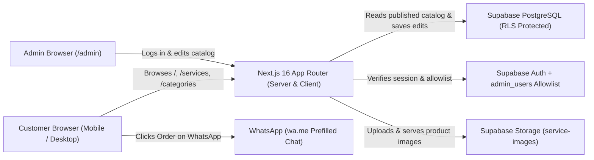

# 01 — Project Overview

[← Back to Documentation Index](./README.md) | [Next: 02 — Getting Started →](./02-getting-started.md)

---

## 1. What is NovaStream?

**NovaStream** is a multilingual digital services and gaming storefront designed for customers in **Morocco**.

It allows visitors to:
1. Browse digital services and gaming subscriptions (such as PlayStation Plus, PlayStation 4/5 games, Xbox Game Pass, video streaming passes, and music subscriptions).
2. Choose exact product options (such as console platform, edition, subscription tier, duration in months, or `Primary` / `Secondary` account access).
3. See the exact price immediately in **Moroccan Dirhams (`MAD` / `DH` / `درهم`)**.
4. Click a button to open **WhatsApp** with a pre-written message in their chosen language to confirm availability and complete their order with the NovaStream team.

It also includes a private **Administration Dashboard (`/admin`)** where the store owner can manage categories, services, prices, translations, images, and website settings without editing source code.

---

## 2. Target Audience and Languages

NovaStream serves two types of users:

1. **Customers (Public Storefront):**
   - Located primarily in Morocco.
   - Browse the website on mobile phones or desktop computers.
   - Can switch between three languages at any time using the header selector:
     - **Français (`fr`)** — Default language (Left-to-Right).
     - **الدارجة (`ar`)** — Natural **Moroccan Darija** written in Arabic script (Right-to-Left), *not* formal Modern Standard Arabic.
     - **English (`en`)** — International English (Left-to-Right).
   - Switching languages updates the page content in-place using a browser cookie (`NEXT_LOCALE`) **without changing the URL**.

2. **Store Administrators (`/admin`):**
   - Authenticated and explicitly approved staff members whose user IDs are listed in the `admin_users` database table.
   - Use an English administration interface to create, edit, translate, publish, or delete catalog items.

---

## 3. High-Level System Diagram

---

## 4. Technology Stack (Actual Installed Versions)

The table below lists the real packages installed in [`package.json`](../package.json) and why each one is used:

| Component | Package & Version | Why It Is Used |
|---|---|---|
| **Framework** | `next` (`16.3.6`) | Provides the App Router, Server Components (fast page loading and SEO), and Server Actions (secure backend mutations). |
| **UI Library** | `react` (`19.2.8`) & `react-dom` (`19.2.8`) | Builds interactive user interfaces using reusable components. |
| **Language** | `typescript` (`^5.7.3`) | Adds strict type checking to JavaScript so bugs are caught before deployment. |
| **Styling** | `sass` (`^1.85.0`) + SCSS Modules | Scopes CSS styles to each component (`*.module.scss`) without using Tailwind CSS. |
| **Database & Auth** | `@supabase/supabase-js` (`^2.49.1`) & `@supabase/ssr` (`^0.6.1`) | Connects Next.js to Supabase PostgreSQL, Supabase Auth, and Supabase Storage with cookie-based sessions. |
| **Localization (i18n)** | `next-intl` (`^4.1.0`) | Loads UI translations (`en.json`, `fr.json`, `ar.json`) in both Server and Client Components. |
| **Validation** | `zod` (`^3.24.2`) | Validates forms, prices, slugs, and settings on both the client and server before touching the database. |
| **Icons** | `lucide-react` (`^1.16.0`) | Provides clean SVG icons (search, arrows, WhatsApp icon, admin icons). |
| **Test Runner** | `tsx` (`^4.19.3`) | Executes the TypeScript automated test suite (`src/__tests__/run-tests.ts`) using Node's native assertion module. |

---

## 5. Feature Status Overview

To keep this documentation 100% honest and accurate, here is the exact status of every feature in the repository:

### Fully Implemented Features
- **Public Storefront:** Homepage (`/`), Services Catalog (`/services`), Service Detail page (`/services/[slug]`), Categories index (`/categories`), Category Detail page (`/categories/[slug]`), About (`/about`), Contact (`/contact`), Privacy Policy (`/privacy`), and Terms (`/terms`).
- **Dynamic Variants & MAD Pricing:** Unlimited variants per service (`platform`, `edition`, `tier`, `duration_months`, `access_type`), integer MAD pricing (`price_mad`, `sale_price_mad`), automatic hiding of irrelevant selectors, and disabling of invalid/unavailable combinations.
- **Cookie-Based Multilingual System (`en`, `fr`, `ar`):** Language switching without changing the URL, Moroccan Darija translations in Arabic script, full RTL layout support, and database translation fallback (`Requested → French → English`).
- **WhatsApp Ordering:** Localized prefilled WhatsApp inquiry links (`https://wa.me/...`) in English, French, and Moroccan Darija.
- **Private Admin Dashboard (`/admin`):** Login (`/admin/login`), Dashboard overview + Services table with direct Edit/Delete buttons (`/admin`), New Service (`/admin/services/new`), Edit Service (`/admin/services/[id]/edit`), Categories CRUD with direct Delete (`/admin/categories`), and Website Settings (`/admin/settings`).
- **Dual-Mode Data Layer (Live Supabase + Local Seed Fallback):** Works with a real Supabase project when `.env.local` is configured, and automatically falls back to an in-memory seeded store (`src/lib/catalog/seed-data.ts`) when Supabase credentials are not set.
- **Database Schema & Security:** Full SQL migrations (`0001_init.sql`, `0002_localization.sql`), `seed.sql`, Row Level Security (RLS) on all 7 tables, non-recursive `public.is_admin()` check, and `service-images` storage policies.

### Partially Implemented Features
- **Website Settings Hero Banner & Footer Customization:** The `site_settings` table and `PublicSiteSettings` type include a `hero_banner` JSON object, and `/admin/settings` edits `whatsappNumber`, `contactEmail`, `supportHours`, `defaultLocale`, and `socialLinks`. However, custom homepage hero headline text and footer copyright text are currently read from the translation JSON files (`src/i18n/messages/*.json`) rather than editable from `/admin/settings`.
- **Image Deletion from Supabase Storage Bucket:** In `src/components/admin/ImageUploader.tsx`, admins can upload new files to the `service-images` bucket and remove image URLs from a service's gallery array, but removing an image from the form does not issue a `storage.from('service-images').remove(...)` call to delete the underlying file from the bucket.

### Planned / Not Implemented Features (By Design for MVP)
- **Online Payment Gateway / Checkout Cart:** Not implemented; orders are handled via WhatsApp inquiry.
- **Customer Accounts:** Customers do not log in or register; only administrators log in at `/admin/login`.
- **Automated Account/Code Delivery:** Fulfillment happens manually on WhatsApp after availability is confirmed.

