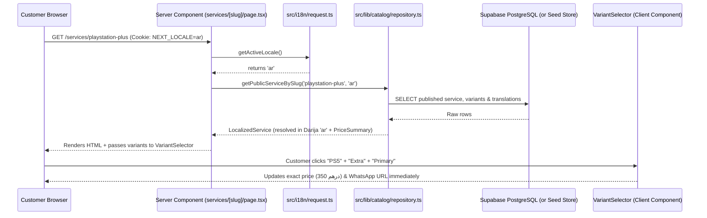
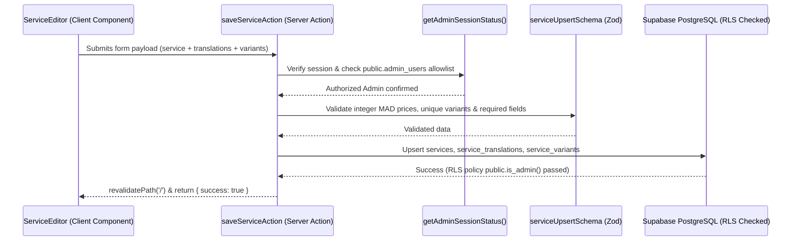

# 03 — Project Architecture

[← 02 — Getting Started](./02-getting-started.md) | [Back to Index](./README.md) | [Next: 04 — Frontend Components →](./04-frontend-components.md)

---

## 1. Key Concepts Explained Simply

Before looking at the folders, let's clarify three important Next.js concepts used in NovaStream:

1. **Next.js App Router (`src/app/`):**
   - In Next.js, folders inside `src/app/` automatically become web pages (routes).
   - For example, `src/app/(storefront)/services/page.tsx` becomes the `/services` page, and `src/app/admin/login/page.tsx` becomes `/admin/login`.
   - Folders wrapped in parentheses like `(storefront)` are called **Route Groups**. They organize files into a shared layout (header + footer) *without* adding `(storefront)` to the URL!
2. **Server Components vs. Client Components:**
   - **Server Components** (the default in Next.js) run only on the server. They fetch data directly from Supabase (`getPublicServices`, `getAdminDashboardStats`) and send finished HTML to the browser. They are fast and secure.
   - **Client Components** start with `'use client';` at the very top of the file. They run in the browser so they can handle clicks, state (`useState`), and interactive filters (`VariantSelector`, `ServiceFilters`, `LanguageSwitcher`, `ServiceEditor`).
3. **Server Actions (`'use server';`):**
   - Functions marked with `'use server';` (like those in [`src/app/admin/actions.ts`](../src/app/admin/actions.ts) and [`src/i18n/actions.ts`](../src/i18n/actions.ts)) are secure backend functions that Client Components can call directly—just like calling a normal JavaScript function—without manually writing REST API endpoints.

---

## 2. Complete Directory Structure

Here is the exact folder structure of the NovaStream repository:

```text
novastream/
├── docs/                                # Complete technical documentation (you are here)
├── public/                              # Static files served directly at "/"
│   ├── favicon.ico                      # Extracted neon N+play favicon (ICO format)
│   ├── logo.png                         # Extracted 512x512 transparent neon N+play logo
│   └── images/
│       ├── categories/                  # SVG icons for the 6 seeded categories
│       └── services/                    # SVG cover & gallery images for seeded services
├── supabase/
│   ├── migrations/
│   │   ├── 0001_init.sql                # Core schema, constraints, triggers, RLS & storage bucket
│   │   └── 0002_localization.sql        # Translation tables & RLS policies
│   └── seed.sql                         # Initial multilingual catalog & settings seed data
├── src/
│   ├── __tests__/
│   │   └── run-tests.ts                 # 12 automated unit & security test suites
│   ├── app/
│   │   ├── layout.tsx                   # Root HTML shell, Google Fonts (Inter & Cairo), favicon metadata
│   │   ├── globals.scss                 # Global CSS reset, CSS variables, RTL helpers
│   │   ├── icon.png                     # Next.js App Router 128x128 favicon
│   │   ├── apple-icon.png               # Apple touch icon (180x180)
│   │   ├── favicon.ico                  # App Router favicon.ico
│   │   ├── robots.ts                    # Generates /robots.txt (disallows /admin)
│   │   ├── sitemap.ts                   # Generates /sitemap.xml dynamically from catalog
│   │   ├── (storefront)/                # Public website route group (shares Header & Footer)
│   │   │   ├── layout.tsx               # Storefront layout with NextIntlClientProvider
│   │   │   ├── StorefrontPages.module.scss
│   │   │   ├── page.tsx                 # Homepage ("/")
│   │   │   ├── services/
│   │   │   │   ├── page.tsx             # Services catalog ("/services")
│   │   │   │   └── [slug]/page.tsx      # Service details ("/services/[slug]")
│   │   │   ├── categories/
│   │   │   │   ├── page.tsx             # Categories list ("/categories")
│   │   │   │   └── [slug]/page.tsx      # Category services ("/categories/[slug]")
│   │   │   ├── about/page.tsx           # About page ("/about")
│   │   │   ├── contact/page.tsx         # Contact page ("/contact")
│   │   │   ├── privacy/page.tsx         # Privacy policy ("/privacy")
│   │   │   └── terms/page.tsx           # Terms & conditions ("/terms")
│   │   └── admin/                       # Private administration dashboard routes
│   │       ├── actions.ts               # Server Actions for Auth, Services, Categories & Settings
│   │       ├── page.tsx                 # Admin Dashboard overview & services table ("/admin")
│   │       ├── login/page.tsx           # Admin login page ("/admin/login")
│   │       ├── services/
│   │       │   ├── new/page.tsx         # Create new service ("/admin/services/new")
│   │       │   └── [id]/edit/page.tsx   # Edit existing service ("/admin/services/[id]/edit")
│   │       ├── categories/page.tsx      # Manage categories ("/admin/categories")
│   │       └── settings/page.tsx        # Manage site & WhatsApp settings ("/admin/settings")
│   ├── components/
│   │   ├── layout/                      # SiteHeader, SiteFooter, LanguageSwitcher, LocaleDocumentSync
│   │   ├── storefront/                  # HeroSection, CategoryGrid, ServiceCard, VariantSelector, etc.
│   │   ├── admin/                       # AdminSidebar, ServiceEditor, VariantEditor, ImageUploader, etc.
│   │   └── common/                      # LoadingSkeleton, EmptyState, ErrorState, ConfirmDialog, Toast
│   ├── i18n/
│   │   ├── request.ts                   # Reads NEXT_LOCALE cookie & loads JSON messages
│   │   ├── actions.ts                   # Server Action to set NEXT_LOCALE cookie
│   │   ├── routing.ts                   # Shared navigation helpers
│   │   └── messages/                    # UI translation files (en.json, fr.json, ar.json)
│   ├── lib/
│   │   ├── supabase/                    # Supabase config, browser client, server client & admin auth check
│   │   ├── catalog/                     # Repository queries, pricing engine & fallback seed data
│   │   ├── validations/                 # Zod schemas for services, variants, categories, settings & images
│   │   ├── formatters.ts                # MAD price, month duration, access type & fallback formatters
│   │   ├── whatsapp.ts                  # Localized WhatsApp message & wa.me URL generator
│   │   └── seo.ts                       # Localized OpenGraph & canonical metadata builder
│   ├── styles/
│   │   ├── _tokens.scss                 # Color palette, border radius, shadows & breakpoints
│   │   └── _mixins.scss                 # Reusable SCSS mixins (container, glass-panel, button-base)
│   └── types/
│       ├── database.ts                  # Exact TypeScript interfaces for PostgreSQL table rows
│       └── catalog.ts                   # Resolved localized models & UI state types
├── .env.example
├── eslint.config.mjs
├── next.config.ts
├── package.json
└── tsconfig.json
```

---

## 3. How Data Flows Through NovaStream

### Public Storefront Request Flow (Read Path)

When a customer visits `/services/playstation-plus`:



### Admin Mutation Flow (Write Path)

When an administrator creates or edits a service in `/admin`:



---

## 4. SCSS Architecture (Why No Tailwind CSS?)

Per the project specification, NovaStream uses **SCSS Modules** instead of Tailwind CSS:

1. **Design Tokens ([`src/styles/_tokens.scss`](../src/styles/_tokens.scss)):** Defines all colors (`$color-bg-primary: #070b14`, `$color-accent-cyan: #06b6d4`, `$color-whatsapp: #25d366`), border radii, and responsive breakpoints (`$breakpoint-md: 768px`, `$breakpoint-lg: 1024px`).
2. **Reusable Mixins ([`src/styles/_mixins.scss`](../src/styles/_mixins.scss)):** Provides `@mixin container`, `@mixin card-surface`, `@mixin glass-panel`, `@mixin focus-ring`, and `@mixin button-base`.
3. **Component-Scoped Modules (`*.module.scss`):** Every component imports its own `.module.scss` file (for example, `import styles from './ServiceCard.module.scss'`). Next.js compiles class names into unique hashes (like `ServiceCard_serviceCard__x8a2`) so styles from one component never accidentally break another component.
4. **Logical Properties for RTL:** Instead of `margin-left` or `padding-right`, the SCSS files use CSS logical properties (`margin-inline-start`, `padding-inline`, `border-inline-start`, `inset-inline-start`). When the language switches to Moroccan Darija (`dir="rtl"`), the browser automatically mirrors the layout without needing duplicate stylesheets.

