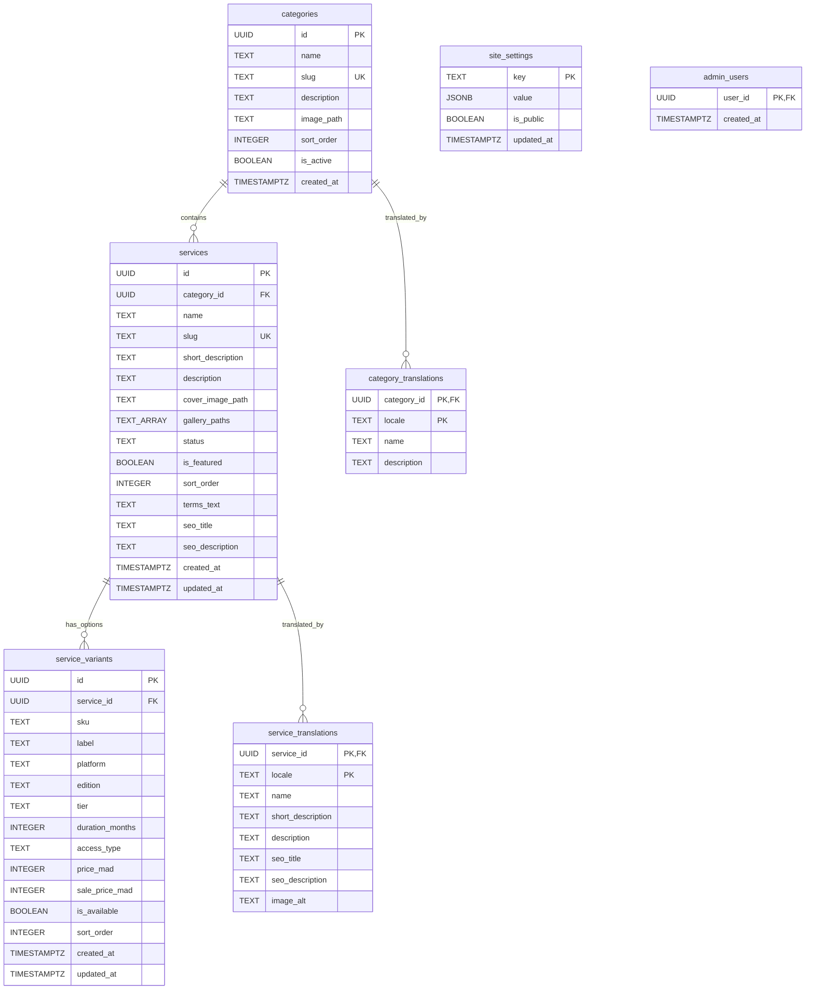

# 05 — Database

[← 04 — Frontend Components](./04-frontend-components.md) | [Back to Index](./README.md) | [Next: 06 — Authentication & Security →](./06-authentication-security.md)

---

## 1. Database Concepts Explained Simply

- **PostgreSQL:** A powerful relational database system used by Supabase. It stores data in structured **tables** (similar to spreadsheets with strict column rules).
- **Primary Key (`PRIMARY KEY`):** A unique identifier (usually a `UUID` like `22222222-2222-4222-8222-222222222201`) that uniquely identifies a single row in a table.
- **Foreign Key (`REFERENCES`):** A column in one table that points to the Primary Key of another table (for example, `services.category_id` points to `categories.id`).
- **Constraint (`CHECK`, `UNIQUE`):** A rule enforced directly by PostgreSQL so invalid data (such as a negative price or a duplicate URL slug) can never be saved, even if someone bypasses the frontend.
- **Migration:** A numbered `.sql` file in [`supabase/migrations/`](../supabase/migrations/) that creates or updates database tables in a repeatable way.

---

## 2. Entity-Relationship (ER) Diagram

NovaStream uses **7 tables** in the `public` schema, defined across [`0001_init.sql`](../supabase/migrations/0001_init.sql) and [`0002_localization.sql`](../supabase/migrations/0002_localization.sql):



---

## 3. Detailed Table Reference

### 3.1 `public.categories`
Stores product categories (such as *PlayStation Plus*, *PlayStation Games*, *Streaming Services*).

| Column | Type | Nullable | Default | Constraints & Purpose |
|---|---|---|---|---|
| `id` | `UUID` | No | `gen_random_uuid()` | Primary Key. |
| `name` | `TEXT` | No | — | Default/canonical category name (`char_length(trim(name)) > 0`). |
| `slug` | `TEXT` | No | — | Unique URL-friendly identifier (`^[a-z0-9]+(?:-[a-z0-9]+)*$`). |
| `description` | `TEXT` | Yes | `NULL` | Default description. |
| `image_path` | `TEXT` | Yes | `NULL` | Path or URL to category icon (e.g., `/images/categories/ps-plus.svg`). |
| `sort_order` | `INTEGER` | No | `0` | Controls display order (lower numbers appear first). |
| `is_active` | `BOOLEAN` | No | `TRUE` | When `FALSE`, hidden from the public storefront. |
| `created_at` | `TIMESTAMPTZ` | No | `NOW()` | Creation timestamp. |

- **Indexes:** `idx_categories_slug` on `(slug)`, `idx_categories_active_sort` on `(is_active, sort_order)`.

---

### 3.2 `public.category_translations`
Stores translated names and descriptions for each category in `en`, `fr`, and `ar` (Moroccan Darija).

| Column | Type | Nullable | Constraints & Purpose |
|---|---|---|---|
| `category_id` | `UUID` | No | Foreign Key → `categories(id) ON DELETE CASCADE`. Part of composite Primary Key `(category_id, locale)`. |
| `locale` | `TEXT` | No | `CHECK (locale IN ('en', 'fr', 'ar'))`. Part of composite Primary Key. |
| `name` | `TEXT` | No | Translated category name (`char_length(trim(name)) > 0`). |
| `description` | `TEXT` | Yes | Translated category description. |

---

### 3.3 `public.services`
Stores each digital service **once** (language-independent fields like slug, images, publication status, and featured flag live here so products are never duplicated across languages).

| Column | Type | Nullable | Default | Constraints & Purpose |
|---|---|---|---|---|
| `id` | `UUID` | No | `gen_random_uuid()` | Primary Key. |
| `category_id` | `UUID` | No | — | Foreign Key → `categories(id) ON DELETE RESTRICT` (prevents deleting a category that still has services). |
| `name` | `TEXT` | No | — | Canonical name (`char_length(trim(name)) > 0`). |
| `slug` | `TEXT` | No | — | Unique URL slug used in `/services/[slug]`. |
| `short_description` | `TEXT` | Yes | `NULL` | Brief summary shown on product cards. |
| `description` | `TEXT` | Yes | `NULL` | Full detailed description. |
| `cover_image_path` | `TEXT` | Yes | `NULL` | Main product cover image URL or path. |
| `gallery_paths` | `TEXT[]` | No | `'{}'` | Array of image URLs/paths for the detail gallery. |
| `status` | `TEXT` | No | `'draft'` | `CHECK (status IN ('draft', 'published', 'archived'))`. Only `'published'` services are visible to customers. |
| `is_featured` | `BOOLEAN` | No | `FALSE` | When `TRUE`, appears in the Homepage Featured Services section. |
| `sort_order` | `INTEGER` | No | `0` | Controls catalog display order. |
| `terms_text` | `TEXT` | Yes | `NULL` | Usage conditions and limitations (e.g., Primary vs. Secondary rules). |
| `seo_title` | `TEXT` | Yes | `NULL` | Default SEO title. |
| `seo_description` | `TEXT` | Yes | `NULL` | Default SEO meta description. |
| `created_at` | `TIMESTAMPTZ` | No | `NOW()` | Creation timestamp. |
| `updated_at` | `TIMESTAMPTZ` | No | `NOW()` | Automatically updated by trigger `trg_services_updated_at`. |

---

### 3.4 `public.service_translations`
Stores localized text for each service in `en`, `fr`, and `ar` (Moroccan Darija).

| Column | Type | Nullable | Constraints & Purpose |
|---|---|---|---|
| `service_id` | `UUID` | No | Foreign Key → `services(id) ON DELETE CASCADE`. Part of Primary Key `(service_id, locale)`. |
| `locale` | `TEXT` | No | `CHECK (locale IN ('en', 'fr', 'ar'))`. Part of Primary Key. |
| `name` | `TEXT` | No | Translated service title. |
| `short_description` | `TEXT` | Yes | Translated card summary. |
| `description` | `TEXT` | Yes | Translated full description. |
| `seo_title` | `TEXT` | Yes | Translated `<title>` tag. |
| `seo_description` | `TEXT` | Yes | Translated `<meta name="description">`. |
| `image_alt` | `TEXT` | Yes | Translated accessible `alt` text for the cover image. |

---

### 3.5 `public.service_variants`
Stores the pricing and selectable options for each service. A service can have 1 variant (flat price) or many variants.

| Column | Type | Nullable | Default | Constraints & Purpose |
|---|---|---|---|---|
| `id` | `UUID` | No | `gen_random_uuid()` | Primary Key. |
| `service_id` | `UUID` | No | — | Foreign Key → `services(id) ON DELETE CASCADE`. |
| `sku` | `TEXT` | Yes | `NULL` | Optional reference code (e.g., `PSP-PS5-EXT-PRI-12`) included in WhatsApp orders. |
| `label` | `TEXT` | No | — | Human-readable option name (e.g., `PS5 Extra Primary 12M`). |
| `platform` | `TEXT` | Yes | `NULL` | Console or device (`PS4`, `PS5`, `Xbox / PC`, or `NULL`). |
| `edition` | `TEXT` | Yes | `NULL` | Game edition or subscription plan (`Standard`, `Ultimate`, `Individual`, `1 Screen 4K`, or `NULL`). |
| `tier` | `TEXT` | Yes | `NULL` | Membership tier (`Essential`, `Extra`, `Premium`, or `NULL`). |
| `duration_months` | `INTEGER` | Yes | `NULL` | `CHECK (duration_months IS NULL OR duration_months > 0)`. |
| `access_type` | `TEXT` | Yes | `NULL` | `CHECK (access_type IS NULL OR access_type IN ('Primary', 'Secondary'))`. |
| `price_mad` | `INTEGER` | No | — | Regular price in integer Moroccan Dirhams (`CHECK (price_mad >= 0)`). |
| `sale_price_mad` | `INTEGER` | Yes | `NULL` | Optional discounted price (`CHECK (sale_price_mad IS NULL OR (sale_price_mad >= 0 AND sale_price_mad < price_mad))`). |
| `is_available` | `BOOLEAN` | No | `TRUE` | When `FALSE`, visibly disabled on the storefront and cannot be ordered. |
| `sort_order` | `INTEGER` | No | `0` | Display order of options. |
| `created_at` | `TIMESTAMPTZ` | No | `NOW()` | Creation timestamp. |
| `updated_at` | `TIMESTAMPTZ` | No | `NOW()` | Updated automatically by `trg_service_variants_updated_at`. |

- **Unique Combination Constraint (`uq_service_variant_combination`):**
  ```sql
  CONSTRAINT uq_service_variant_combination UNIQUE NULLS NOT DISTINCT (
    service_id, platform, edition, tier, duration_months, access_type, label
  )
  ```
  This PostgreSQL 15+ constraint ensures that even when some columns are `NULL`, duplicate variant combinations cannot be inserted for the same service.

---

### 3.6 `public.site_settings`
Stores global key-value settings in `JSONB` format.

| Column | Type | Nullable | Default | Purpose |
|---|---|---|---|---|
| `key` | `TEXT` | No | — | Primary Key (e.g., `'whatsapp_number'`, `'contact_email'`, `'support_hours'`, `'social_links'`). |
| `value` | `JSONB` | No | — | JSON value for the setting. |
| `is_public` | `BOOLEAN` | No | `TRUE` | When `FALSE` (e.g., `'internal_admin_notes'`), RLS blocks public visitors from reading the row. |
| `updated_at` | `TIMESTAMPTZ` | No | `NOW()` | Last modification timestamp. |

---

### 3.7 `public.admin_users`
Explicit allowlist of administrator UUIDs.

| Column | Type | Nullable | Default | Purpose |
|---|---|---|---|---|
| `user_id` | `UUID` | No | — | Primary Key & Foreign Key → `auth.users(id) ON DELETE CASCADE`. |
| `created_at` | `TIMESTAMPTZ` | No | `NOW()` | When the admin was added to the allowlist. |

---

## 4. Practical Code Examples from the Project

### Example 1: Fetching Published Services (`src/lib/catalog/repository.ts`)

Here is how [`getPublicServices`](../src/lib/catalog/repository.ts) fetches published services, their translations, and their variants in parallel:

```typescript
const [{ data: svcs }, { data: trans }, { data: vars }] = await Promise.all([
  supabase
    .from('services')
    .select('*')
    .eq('status', 'published')
    .order('sort_order', { ascending: true }),
  supabase.from('service_translations').select('*'),
  supabase
    .from('service_variants')
    .select('*')
    .order('sort_order', { ascending: true }),
]);
```

**Step-by-step explanation:**
1. `Promise.all([...])` runs all three database queries at the same time instead of waiting for one to finish before starting the next.
2. `.from('services').select('*').eq('status', 'published')` selects only services whose `status` is `'published'`. (Even if someone removed `.eq('status', 'published')` from the TypeScript code, Supabase's Row Level Security policy would still block draft services from being returned to anonymous visitors!)
3. `.order('sort_order', { ascending: true })` sorts the results so lower `sort_order` numbers appear first.
4. `resolveLocalizedService(...)` then combines each service row with its matching translation (`Requested Locale → French → English`) and computes its `priceSummary`.

---

### Example 2: Updating a Service and Its Translations (`src/app/admin/actions.ts`)

Here is how [`saveServiceAction`](../src/app/admin/actions.ts) updates a service translation using `.upsert(...)`:

```typescript
const { error: trErr } = await supabase
  .from('service_translations')
  .upsert({
    service_id: serviceId,
    locale: loc,
    name: tr.name.trim(),
    short_description: tr.short_description ?? null,
    description: tr.description ?? null,
    seo_title: tr.seo_title ?? null,
    seo_description: tr.seo_description ?? null,
    image_alt: tr.image_alt ?? null,
  });
```

**Step-by-step explanation:**
1. `.from('service_translations')` targets the translation table.
2. `.upsert({...})` is short for "update or insert". Because `(service_id, locale)` is the Primary Key of `service_translations`, PostgreSQL checks if a row for that `service_id` and `locale` (e.g., `'ar'`) already exists:
   - If it exists, PostgreSQL **updates** that row.
   - If it does not exist yet, PostgreSQL **inserts** a new row.
3. If `trErr` is returned (for example, if the user is not an authorized admin), the Server Action stops and returns `{ success: false, error: trErr.message }`.

